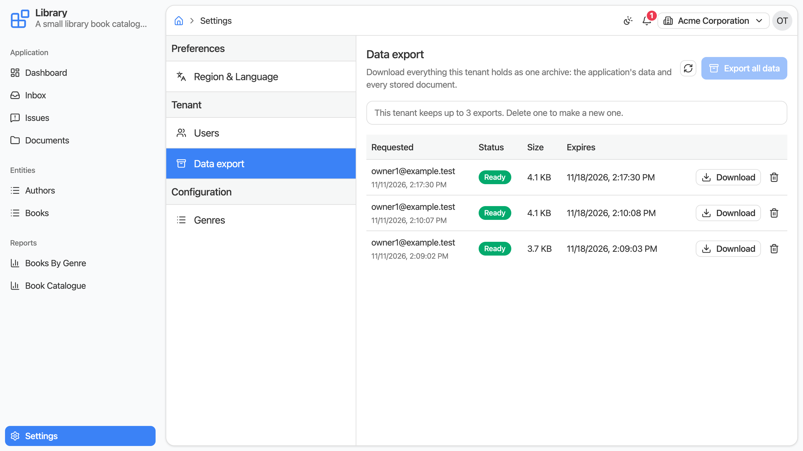

# Tenant data export

Off by default. The **Settings -> Data export** section of the application shell lets a tenant's
owners download everything the tenant holds as one archive: the application's data and every stored
document. Generated application shells mount the same section.

```bash
DIRIGIBLE_TENANT_EXPORT_ENABLED=true
```



## What is in the archive

One ZIP file, named `tenant-<tenant id>-data-export-<date>-<time>.zip`:

```
manifest.json     the tenant, when the archive was made, each table with its row count, the number of files
database/         per application table its definition (<TABLE>.json) and its rows (<TABLE>.csv)
files/            the tenant's documents, as the Documents section shows them
```

- The tables are the ones the published applications declare.
- The documents are those of the whole tenant, including folders restricted to roles the owner does not
  hold.
- Users and roles, process and task history, and logs are not in it.

The `database/` folder keeps the layout the platform's schema export process writes, so its schema
import process restores it. The `files/` folder is a plain tree, so the Documents section's zip upload
puts it back.

## How it works

**Export all data** starts an export in the background and the list follows it until it is **Ready**.
Then **Download** fetches the archive, and the trash button deletes it after a confirmation.

- One export runs at a time per tenant.
- A tenant keeps a limited number of archives. When it has that many, a further export is refused
  until one is deleted or expires.
- An archive is deleted on its own once its retention period is over. The list shows when.
- An export that fails is listed as **Failed** with the reason, and leaves no files behind.

## Who may use it

- A holder of the tenant's `Owner` role, a `DEVELOPER` or an `ADMINISTRATOR`.
- It always exports the tenant the caller is working in. Nothing in a request can choose another
  tenant, a data source or a path.

## Configuration

| Variable | Default | Purpose |
| -------- | ------- | ------- |
| `DIRIGIBLE_TENANT_EXPORT_ENABLED` | `false` | Shows the section and exposes its API. |
| `DIRIGIBLE_TENANT_EXPORT_MAX_ARCHIVES` | `3` | How many archives a tenant may keep at a time. |
| `DIRIGIBLE_TENANT_EXPORT_RETENTION_DAYS` | `7` | How many days an archive is kept before it is deleted. |

## API

The section's own API, under `/services/data/tenant-export`, for the same callers. With the feature
off every route answers `404`.

### Start an export

`POST /services/data/tenant-export` starts an export of the caller's tenant. It takes no body.

| Status | Meaning |
| ------ | ------- |
| `202` | started; the body is the export, `REQUESTED` |
| `409` | an export is still running, or the tenant keeps as many archives as it may |

### List and read

`GET /services/data/tenant-export` answers the tenant's exports, newest first, and
`GET /services/data/tenant-export/{id}` one of them.

```json
{
  "id": 12,
  "status": "COMPLETED",
  "requestedBy": "owner@example.com",
  "requestedAt": "2030-01-15T10:15:30Z",
  "completedAt": "2030-01-15T10:15:42Z",
  "expiresAt": "2030-01-22T10:15:42Z",
  "sizeBytes": 48211,
  "archiveName": "tenant-acme-data-export-20300115-101530.zip"
}
```

`status` is `REQUESTED`, `RUNNING`, `COMPLETED` or `FAILED`; a failed export carries `error`.

| Status | Meaning |
| ------ | ------- |
| `200` | the export, or the list |
| `404` | there is no such export in the caller's tenant |

### Download the archive

`GET /services/data/tenant-export/{id}/archive` answers the ZIP file as an attachment.

| Status | Meaning |
| ------ | ------- |
| `200` | the archive |
| `404` | there is no such export in the caller's tenant |
| `409` | the export has no archive: it still runs, or it failed |
| `410` | the archive has expired |

### Delete an export

`DELETE /services/data/tenant-export/{id}` deletes the export with its archive.

| Status | Meaning |
| ------ | ------- |
| `204` | deleted |
| `404` | there is no such export in the caller's tenant |
| `409` | the export is still running |

### Limits

`GET /services/data/tenant-export/context` answers `{ "maxArchives": 3 }`.

## See also

- [Multi-tenancy](/help/setup/multi-tenancy)
- [Tenant users](/help/setup/tenant-users)
- [Backups and export](/help/operate/backups-and-export)
- [Environment variables](/help/setup/environment-variables#multi-tenancy)
